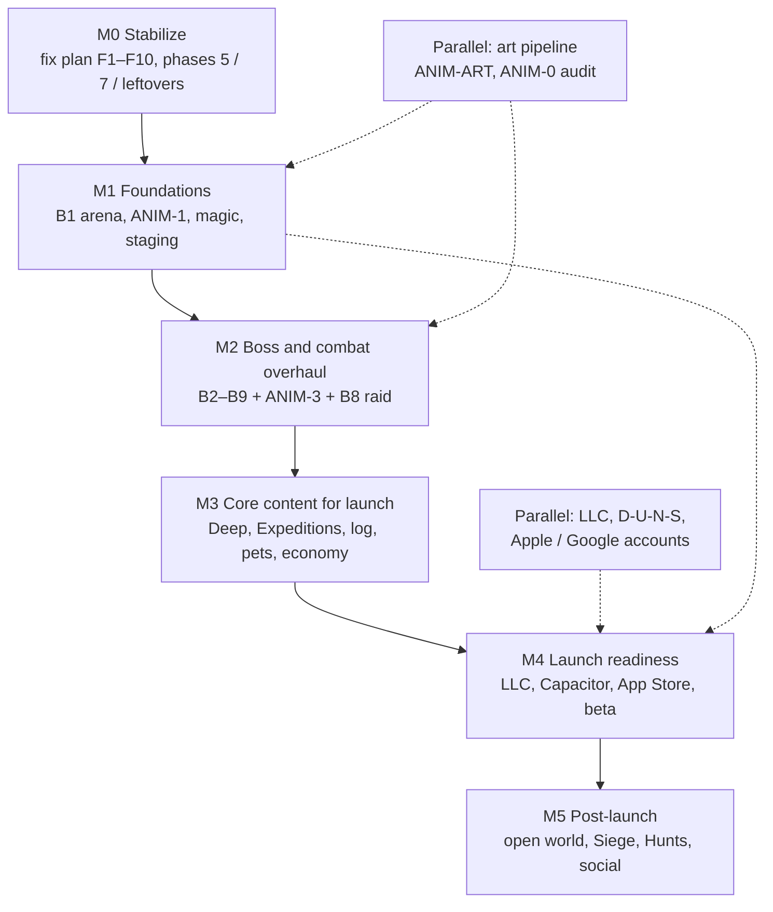

# Xscape release roadmap

This is the top-level overview of how we take Xscape from the current web game to a legitimate public release. Individual plans, task IDs, and Kellen's decisions stay in the docs they already live in — this file only sequences them. Start here, then open the linked plan. The [plans index](README.md) remains the catalog and the consolidated [open decisions for Kellen](README.md#open-decisions-for-kellen) list.

**Nothing in this roadmap changes an existing decision.** Items pulled from [IDEAS](plans/IDEAS.md) that are not already a written plan are marked **proposed for launch — Kellen to confirm**. They must be turned into a plan with Do / Done when / Verify before anyone builds them.

Sizing (S / M / L) is **rough**, for sequencing only. There are no calendar ship dates here. A few week-scale waits already recorded in IDEAS (LLC / D-U-N-S / App Review) are repeated as rough and are not new estimates.

---

## Vision

Xscape is a phone-first, OSRS-feel boss game: short, hard fights you can hop into for a minute that turn into hours, with reasons to pull friends in. We are aiming at a real public release (iPhone App Store first, then Google Play, and a kept web version), not a side project that stays on GitHub Pages forever.

**Guiding principles** (Kellen, 12 Nov 2026, recorded in [IDEAS](plans/IDEAS.md)):

- **Be our own game.** Borrow the feel of OSRS where it's worth it, but don't copy more of its systems. Grow from short, hard boss fights on a phone.
- **Play your own way.** Many things to do, and many ways to do them: several paths to gold and gear, builds over one best setup.
- **WoW-style leveling with a small grind** for any new skill: early levels come quickly, the last few take a real but reasonable push, and there is no 99-style wall.
- **Harder gold.** People like working for gold. Cut raw GP from boss drops, add sinks, and let skilling be a steady earner — numbers still need a balance pass (**IDEAS-ECON**).
- **No predatory monetization.** Keep a free version. A membership is likely later, and is parked until after launch.
- **Phone first.** 390×844 is the design target. iPhone App Store is the primary store; Android is second; the web version stays.

---

## Milestones at a glance

| Milestone | Goal | Rough size |
|---|---|---|
| [M0 Stabilize](#m0-stabilize) | Finish the bug / security / combat / rename work so the live game is safe to build on. | L (many S/M items) |
| [M1 Foundations](#m1-foundations) | Shared arena engine, animation system and art pipeline, magic (if approved), staging and core infra. | L |
| [M2 Boss & combat overhaul](#m2-boss--combat-overhaul) | Rebuild every boss (and Gloamhold rooms) on the new engine, with tells, animation, and signed-off feel. | L |
| [M3 Core content for launch](#m3-core-content-for-launch) | The must-have modes and retention loops, once Kellen confirms the launch set and each item has a plan. | L |
| [M4 Launch readiness](#m4-launch-readiness) | LLC / Apple / Capacitor / store checklist, privacy, account deletion, private repo, analytics, closed beta. | M–L |
| [M5 Post-launch](#m5-post-launch) | Open world, Siege, Hunts, infusion forge, social, membership later. | L, after ship |

M1 work (arena, animation system, magic sign-off, staging) can overlap once M0's security-critical items (**F1**, **F10**, leftover reward-RPC holes) have shipped. Boss reworks in M2 must not start in code until **B1** exists and **B9** feedback is filled in. M3 content is not an execution list until Kellen confirms it and each idea is written as a plan. M4 paperwork can start on day one (see [Parallel tracks](#parallel-tracks)).

---

## M0 Stabilize

**Goal.** Close the remaining [fix plan](plans/XSCAPE_FIX_PLAN.md) work so GP, items, combat, multiplayer, and names are trustworthy. This is the current execution front. F1, F7, and F10 come first.

**Plan items** (existing IDs; do not start later phases in the same session as a security fix):

- **First:** [F1](plans/XSCAPE_FIX_PLAN.md) drop `merge_local_save` (feeds the [reward RPC appendix](plans/appendices/REWARD_RPC_AUDIT.md)), [F7](plans/XSCAPE_FIX_PLAN.md) / 4.7a targeting and auto-retaliate, [F10](plans/XSCAPE_FIX_PLAN.md) late-fight consumable flush. Rough: F1 S, F7 M, F10 S–M.
- **Then F2–F6, F8, F9**, plus leftover 12 Nov review findings on items already marked Done but 🟡/❌ (especially 1.2 mint path, 4.7 regression, 6.3, and the “smaller items” listed under the F-table: 4.6 tests, 4.9 footprints, 6.1/6.2 leftovers, 3.3 remaining if-chains, 3.1 `raid.html` / FIX-Q2, 1.5 dupes query). Rough: mostly S–M.
- **[RPC-1](plans/appendices/REWARD_RPC_AUDIT.md) through [RPC-5](plans/appendices/REWARD_RPC_AUDIT.md)** as Kellen allows. RPC-1 overlaps **F5** (drop the world-boss legacy path). Watch `save_rejections` is operational, not a design fork.
- **Fix-plan phases [5.1–5.2](plans/XSCAPE_FIX_PLAN.md)** (group raid and duel sync, L) and **[7.1–7.6](plans/XSCAPE_FIX_PLAN.md)** including 7.5b (Jad → Magmor / Kree → Vaelkor / Armadyl → Stormwing renames, M–L).
- **[FIX-4.5-a–g](plans/appendices/COMBAT_RULES_DIFF.md)** only after Kellen answers; apply only what he approves. Audit is already done.
- Re-check **[RAID-T1](plans/RAID_DESIGN.md)** (shared tile-attack helper). Any 9×9 or room-size change waits on **B8** in M2. RAID-T2–T4 are already Done.

Phase 0 (0.1 staging project, 0.2 migration order, 0.3 security tests, 0.4 two-client setup) was skipped and is still needed for some Verify steps. **0.2 / 0.3** belong in M0 (they help us prove F-items). **0.1 / 0.4** and the pre-launch Supabase Pro upgrade sit with [M1 infra](#m1-foundations).

**Dependencies.** None from later milestones. Re-check file:line references against `main` before starting each task. Do not persist boosted `PlayerStats` to the cloud. Do not edit already-applied migrations.

**Exit criteria.**

- F1–F10 and the leftover review findings are Done, with each item's Verify run in a real browser (and SQL Verify where the plan says so).
- Phases 5 and 7 are Done (or explicitly deferred by Kellen with a written reason).
- 4.5 numbers are either changed to match Kellen's answers or explicitly left alone.
- `scripts/qa.sh` stays green. No client path can mint GP or items except shop, loot, trade, and duel.

**Answer first.** [FIX-Q2](README.md#open-decisions-for-kellen) (leaving mid-fight), [FIX-Q3](README.md#open-decisions-for-kellen) (weapon ranges), [FIX-Q4](README.md#open-decisions-for-kellen) (existing dupes), [FIX-Q5](README.md#open-decisions-for-kellen) (legacy imports), [FIX-4.5-a through g](README.md#open-decisions-for-kellen), [RPC-1 through RPC-5](README.md#open-decisions-for-kellen). FIX-Q1 is already resolved.

---

## M1 Foundations

**Goal.** Put the shared systems in place so every later boss, animation, and new mode is built once, not as a one-off. Also stand up staging and the infra we will need to verify and host a real release.

**Plan items.**

- **[B1 Shared arena engine](plans/BOSS_MECHANICS_PLAN.md)** — B1.1 top-down (already decided) → B1.2 `arena.js` → B1.3 moving bodies → B1.4 tile-size / optional camera → B1.5 distance-map check for every boss. Rough: L. This is a prerequisite for M2. B1 is planning-only until the bug-fix run reaches it.
- **[Animation system](plans/ANIMATION_PLAN.md)** — **ANIM-0** audit first (every unit and action: animated / static / missing; S, then Kellen reviews). **ANIM-ART-0** audit of how player gear art is built today, then **ANIM-ART** pipeline (Option A 3D-to-sprite vs Option B layered 2D; Kellen approved this as the decision frame, not the choice). **ANIM-1** shared sprite-animation helper used by the player and one boss (M). **ANIM-2** (player walk / run / style attacks / eat / drink / hit / death) follows **ANIM-Q2**. **ANIM-3** waits for M2 so each boss is animated once, after its mechanics are final. Original art only; must stay smooth at 390×844. No real-time 3D renderer.
- **[Magic system](plans/proposals/MAGIC_SYSTEM_PROPOSAL.md)** — **proposal only, not approved.** Do not implement until Kellen signs off through Gameboy on **MAGIC-Q1–Q4** and the proposal is turned into a plan with Do / Verify. Related: **BOSS-B3.4-spell** (M2) needs a signed-off magic design. Rough if approved: L.
- **Staging / infra** (from [fix plan Phase 0](plans/XSCAPE_FIX_PLAN.md) and [IDEAS, Infrastructure](plans/IDEAS.md)): **0.1** separate staging Supabase project, **0.4** two-client test setup, and a path onto **Supabase Pro** (daily backups, no pausing) before launch. Hosting move (GitHub Pages → Cloudflare Pages or Vercel, custom domain) can be *prepared* here and cut over in M4 with the private-repo and analytics work.

**Dependencies.** M0 security-critical items should already be in (F1, F10, F5 / RPC-1 especially). Magic and the art pipeline need their open questions answered before build, not after. B1.4 camera is only if tiles are too small on 360 px phones.

**Exit criteria.**

- One shared arena module is in use for a pilot layout, with distance maps drawn for current bosses.
- ANIM-0 and ANIM-ART-0 are in the animation plan and reviewed; ANIM-Q3 is decided; ANIM-1 is shipping on the player and one boss.
- Magic is either a signed-off plan ready to build (or already built) **or** explicitly deferred by Kellen, with a written note on what happens to **BOSS-B3.4-spell**.
- Staging project exists; security and two-client tests can run against it.

**Answer first.** [MAGIC-Q1–Q4](README.md#open-decisions-for-kellen) (if we are taking magic in this milestone), [ANIM-Q1](plans/ANIMATION_PLAN.md) (frame budget / style), [ANIM-Q3](plans/ANIMATION_PLAN.md) (pipeline A, B, or B now and A later; after ANIM-ART-0), [ANIM-Q2](plans/ANIMATION_PLAN.md) (player first vs bundled with the first boss pass), [BOSS-B1.4](README.md#open-decisions-for-kellen) after the tile-size check.

---

## M2 Boss & combat overhaul

**Goal.** Every current boss, and Gloamhold, plays as a designed 9×9 (or signed-off variant) fight: mixed styles, readable tells, movement where planned, and animation that is the tell. Kellen's 13 Nov planning decisions are already in the boss plan and are not revisited here: **B2.4** (Widow), **B3.4** (Knight-King minions), **B6.1** (Vaelkor redesign).

**Plan items** — follow the [boss plan suggested order](plans/BOSS_MECHANICS_PLAN.md):

1. **[B9](plans/BOSS_MECHANICS_PLAN.md)** feedback session: per-boss target kill times and damage bands (**BOSS-B9-bands**). Fill this in *before* starting B2–B8 in code.
2. **[B2 Widow Queen](plans/BOSS_MECHANICS_PLAN.md)** as the pilot (9×9, ranged attack, retune, plus B2.4). Proves the engine. Then **ANIM-3** for Widow.
3. **[B5 Drowned Colossus](plans/BOSS_MECHANICS_PLAN.md)** (stationary like Widow), then its ANIM-3 pass.
4. **[B3 Hollow Knight-King](plans/BOSS_MECHANICS_PLAN.md)** (including B3.4) and **[B4 Gorehorn](plans/BOSS_MECHANICS_PLAN.md)** (walking bosses; uses B1.3), each with ANIM-3. **BOSS-B3.4-spell** needs the M1 magic sign-off.
5. **[B6 Vaelkor](plans/BOSS_MECHANICS_PLAN.md)** (B6.1 already decided: summoned-guard phase, return HP, whirlwind rate, minion max 18) once **BOSS-B6-arena**, **BOSS-B6.1-info**, and **BOSS-B6.1-hp** (“about 75”) are answered. **[B7 Magmor](plans/BOSS_MECHANICS_PLAN.md)** once **BOSS-B7-lane** is answered. **[B8 Gloamhold](plans/BOSS_MECHANICS_PLAN.md)** rooms once **BOSS-B8-rooms** is answered; design text stays in [RAID_DESIGN.md](plans/RAID_DESIGN.md).

Each boss follows the plan's verification pattern (B2–B7). Rough: M–L per boss, not counting art.

**Dependencies.** **B1** and **ANIM-1** from M1. New attacks need their own animation and tell (animation plan). Do not retune a boss in code before B9 bands are written down. Do not open B6 / B7 / B8 in code before those arena decisions.

**Exit criteria.**

- Every current boss and the raid have been moved (or explicitly kept) to their signed-off arena, with Kellen's B2.4 / B3.4 / B6.1 behaviour in the game, not only in the plan.
- Each fight has been verified in a real phone-sized browser and Kellen has tested feel against the B9 bands.
- Info pages match the live fights (including Vaelkor text once **BOSS-B6.1-info** is written).
- ANIM-3 is done for those bosses and their minions (idle, walk, each attack, special, hit, death, and Vaelkor's air phase).

**Answer first.** [BOSS-B9-bands](README.md#open-decisions-for-kellen) before any B2–B8 code; [BOSS-B6-arena](README.md#open-decisions-for-kellen), [BOSS-B7-lane](README.md#open-decisions-for-kellen), [BOSS-B8-rooms](README.md#open-decisions-for-kellen) before those encounters; [BOSS-B3.4-spell](README.md#open-decisions-for-kellen) (needs magic); [BOSS-B6.1-info](README.md#open-decisions-for-kellen) and [BOSS-B6.1-hp](README.md#open-decisions-for-kellen). [BOSS-B1.4](README.md#open-decisions-for-kellen) if not already closed in M1.

---

## M3 Core content for launch

**Goal.** Ship the retention and progression loops that make Xscape a game you come back to, not only a boss list. Everything in this milestone is **proposed for launch — Kellen to confirm**. None of it is an execution plan yet. After confirmation, Gameboy writes each approved item as a plan with Do / Done when / Verify, Kellen signs off on design and balance, and only then do we build.

**Proposed for launch — Kellen to confirm** (must-haves Kellen already marked in [IDEAS](plans/IDEAS.md); not a new decision, just a launch-set proposal):

| Item | Why it's in this proposal | Notes |
|---|---|---|
| **The Deep** (⭐ top pick) with **Mining** and **Relics** | Top pick, 12 Nov; Mining and Relics are liked and designed as Deep systems. | Endless descending dungeon from our bosses; rare ores between fights; relics found and upgraded in the Deep. |
| **Expeditions** with **streaks and dailies** | Liked; Kellen asked to pair streaks with Expeditions. | 1–8 hour companion trips, distress calls, daily/weekly bounties in a token for cosmetics or pets. Missing a day doesn't wipe progress. |
| **Collection log** | Kellen: must have. | Needs a plan (what is logged, where it lives, how it syncs). |
| **Boss pets** | Kellen: must have. | Rare drops that follow the player around the hub. |
| **Companion bond / favor** | Liked, 12 Nov. | Favor for Deep supply runs and bank trips; earned by helping the companion (e.g. distress calls). |
| **Economy pass** ([IDEAS-ECON](README.md#open-decisions-for-kellen)) | Direction decided 12 Nov: harder gold, more sellable drops, gold sinks. | **Numbers need a balance pass and sign-off before anything ships.** Sinks can use launch systems (relic upgrades, companion favor) without pulling post-launch sinks (infusions, fort upgrades) forward. |

Other ideas Kellen liked (Siege and wall stones, Hunts, the infusion forge, day/night and weather, account styles) stay in [M5](#m5-post-launch) unless he moves them up when he confirms this set.

**Dependencies.** M0–M2 should be in, so Deep floors can reuse signed-off boss fights rather than old one-off arenas. Expeditions / streaks benefit from later native push notifications (M4 Capacitor), but a web version can ship first. Economy pass should be designed before Deep and boss loot are considered “launch final.”

**Exit criteria.**

- Kellen has confirmed, changed, or cut the launch set in writing.
- Each confirmed item has a plan, sign-off, implementation, and Verify in a real browser, plus Kellen's own playtest.
- IDEAS-ECON numbers are signed off and live (or explicitly staged behind a flag he approved).

**Answer first.** Confirm or cut this launch set. [IDEAS-ECON](README.md#open-decisions-for-kellen) numbers. Any new design questions that appear once the plans are written.

---

## M4 Launch readiness

**Goal.** Make the build, legal entity, store listing, hosting, and privacy bar of a real shipped game. Source for the checklist: [IDEAS, Distribution and Infrastructure](plans/IDEAS.md) (Kellen, 12 Nov). Suggested timing already recorded there: stay web while iterating; wrap for public launch, iOS first, then Android. The App Store checklist in IDEAS is rough (~3–5 weeks with an LLC, including a ~1–2 week D-U-N-S wait) and is not a ship date.

**Plan items** (checklist; several can run in parallel with M0–M3 — see [Parallel tracks](#parallel-tracks)):

1. Form the LLC (Kellen wants to publish under one; he has a Mac).
2. Free D-U-N-S number for the LLC (rough: ~1–2 weeks).
3. Enroll in the Apple Developer Program as an organization ($99/yr). Google Play ($25 once) when Android is in scope.
4. Capacitor wrap of the existing HTML5 game (one codebase → web, iOS, Android; no rewrite): icons, splash, safe areas, backgrounding, TestFlight on a real iPhone (IDEAS rough: ~2–4 dev days; can run during the D-U-N-S wait).
5. Sign in with Apple if other social logins exist.
6. Listing: screenshots, description, age rating, privacy policy URL, **privacy label**, in-app **account deletion**.
7. App Review (IDEAS rough: ~1–3 days; first submission may bounce once).
8. Infra cutover: **Supabase Pro** if not already on it; make the GitHub repo **private** before launch; move the web host from GitHub Pages to **Cloudflare Pages or Vercel** (custom domain, preview builds); add error reporting (e.g. **Sentry**) and basic retention analytics.
9. Performance pass on a real phone (390×844), including the animation budget from ANIM-Q1.
10. **Closed beta** (TestFlight / web allow-list) and a go/no-go from Kellen after it.

Payments in the iOS app must use Apple IAP if we charge (15% under the Small Business Program, else 30%). Monetization itself stays parked — see M5.

**Dependencies.** A stable feature set from M0–M3 (or a beta slice Kellen names). Paperwork does not wait on M3. Account deletion and the privacy policy / label need a written behaviour (what is deleted, what is retained) before the listing is submitted.

**Exit criteria.**

- LLC and Apple org account are in place.
- A TestFlight (and, if we are shipping Android with 1.0, a Play) build runs the current game on a real phone.
- Privacy policy, privacy label, and in-app account deletion are live and accurate.
- Repo is private; production is on Pro + the chosen web host, with Sentry and basic analytics.
- Closed beta completed; Kellen signs off to submit.

**Answer first.** Confirm iOS-only vs iOS+Android for 1.0, the web host (Cloudflare Pages vs Vercel), what account deletion erases, and whether any login besides the current one forces Sign in with Apple. No existing design decision is changed by asking these.

---

## M5 Post-launch

**Goal.** The bigger systems Kellen wants, that are too large (or lower priority) to treat as 1.0 must-haves unless he moves them into M3.

**Parked here** (from [IDEAS](plans/IDEAS.md); liked or needed, not launch-proposed unless he says so):

- **Open world** (Kellen, 12 Nov: needed, but a huge update). Natural home for Hunts, caravans, ore spots, night/weather, expedition trails, world-boss arenas.
- **Siege** and wall stones / personal or clan fort.
- **Hunts.**
- **Infusion forge** (timed infusions; a gold sink).
- **Social:** clans, arena seasons, bonded duos, daily duo boss, invite rewards, and the other 💡 social items.
- **Membership later** (monetization is parked, not a priority; keep a free version; remember Apple's cut). Marketing (build-in-public on X, a possible separate account, SpaceX policy check) also stays parked.

💡 ideas not listed above stay in IDEAS until Kellen picks them up. Tick-accurate co-op (Deep duos, Siege) may later need a small dedicated game server; Supabase still holds accounts and items.

**Dependencies.** A live 1.0, plus whatever M3 systems they hook into (Deep, companions, economy). Each item still needs a plan and sign-off before build.

**Exit criteria.** Per-feature, after launch; not a single gate.

**Answer first.** After 1.0, which of these is the first post-launch bet (open world is the huge one; Siege / Hunts / forge are smaller bets).

---

## Parallel tracks

These do not have to wait for M0 to finish. They should be started early so M4 is not blocked on paperwork or art.

| Track | What can run now | Lands in |
|---|---|---|
| **Business / legal** | Form the LLC, apply for the D-U-N-S number, enroll in Apple Developer (and later Google Play). Kellen owns this; bots cannot form an LLC for him. | M4 |
| **Art** | ANIM-0 audit support, ANIM-ART-0 (how gear art is built today), concepting toward ANIM-Q1 / ANIM-Q3, original player and boss frames once the pipeline is chosen. Owner: Item & Character Design, with Gameboy on hook-up. | M1 system, M2 boss passes, M3 content art |
| **Infra prep** | Staging project (0.1), host evaluation (Cloudflare Pages vs Vercel), Sentry/analytics account setup (no production cutover until M4). | M1 / M4 |
| **Marketing** | Parked. Check outside-work policy before any public build-in-public series. | After Kellen unparks it |

---

## How we work

1. **Plan.** The work is written in a plan doc with a stable ID, Status, and Do / Done when / Verify. IDEAS items are not executable until that happens.
2. **Kellen signs off** on design and balance (and on any item in the [open decisions](README.md#open-decisions-for-kellen) list) *before* build. Bots do not invent numbers or change existing decisions.
3. **Build** only the signed-off item (or a tight batch). Follow [CLAIM.md](../CLAIM.md) and [OWNERS.md](../OWNERS.md). Re-check the plan against `main` first. Stamp client ships per [RELEASE.md](../RELEASE.md).
4. **Verify in a real browser** (phone-sized, 390×844, not only unit tests). Run the Verify steps in the plan. `scripts/qa.sh` stays green.
5. **Kellen tests** the change in the live (or TestFlight / staging) build before we call the item done.

**Usage budgeting per session.** One session should finish a single plan item or a small, named batch (for example F1 alone, or F7 + its 4.7a tests — not “start M2”). Leave headroom at the end of the session for Verify, a clean commit/push, and a short report. Do not start the next milestone, and do not start later phases, in a session that is already on a fix or that is near the usage stop line. If a decision is blocked on Kellen, stop and ask; do not guess.

---

## Where to go next

The current execution front is **M0**: [F1, F7, and F10](plans/XSCAPE_FIX_PLAN.md) first, after the open M0 decisions Kellen still needs to answer. In parallel, Kellen can start the LLC and, when ready, confirm or cut the [M3 launch set](#m3-core-content-for-launch) and the remaining [open decisions](README.md#open-decisions-for-kellen).

## Kellen confirmations (Nov 13, 2026)
- The proposed M3 launch set and M5 split look good. The plan will keep being refined.
- **Next design task, RELIC-DESIGN:** decide which relics exist and how the system works: how you get them, slots (the current idea is up to 3 equipped), upgrades from duplicates, whether they work only in The Deep or everywhere, and how they support "play your own way" builds. See the Relics section in [IDEAS.md](plans/IDEAS.md). Needed before The Deep is planned in M3.

- PVP-1 (Kellen, Nov 13): hide the Duel Arena in M0; new original PvP content is a pre-launch M3 item (design session needed). Keep the Duel Arena area itself to repurpose for the new PvP.
- LEVEL-REDO (Kellen, Nov 13): possible leveling rework; decide before M2 boss tuning and the M3 economy pass.
- NET-1 (Kellen, Nov 13): server-run raids and PvP, M1. Path A (multiplayer only) vs Path B (all combat) plus cost and scaling caveats to revisit before building.
- Planning rule (Kellen, Nov 13): when there are several correct paths, write them all down and revisit before implementing.
- CAMERA-1 (Kellen, Nov 13, revised): one game-wide 2D camera that follows the player but stops at area edges; boss rooms sized to fit the screen so they never scroll (M1). Never 3D or rotating.
- MAGIC-BOOK (Kellen, Nov 13): design the first complete spellbook (combat and utility spells, gates, staff requirements, rune costs) before building magic in M1. Spells need no weapon, only runes; Nightfall staff is rune-charged.
- TUTORIAL-1 (Kellen, Nov 13): guided first Magmor fight teaching prayer, eating, potions and healers; launch-critical for trial conversion (M3, with BOSS-B7 and GUEST-1).
